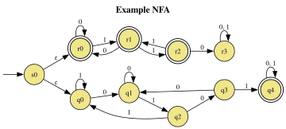
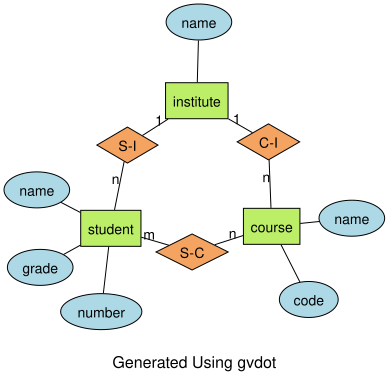
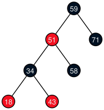
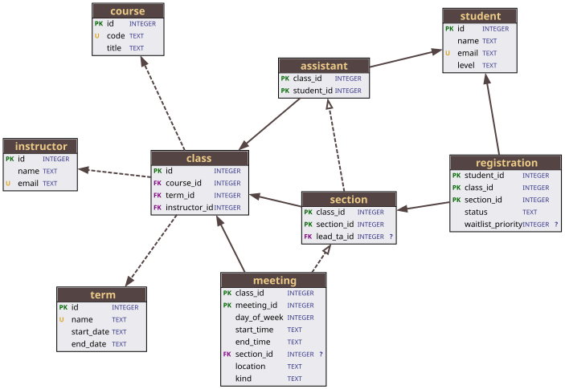
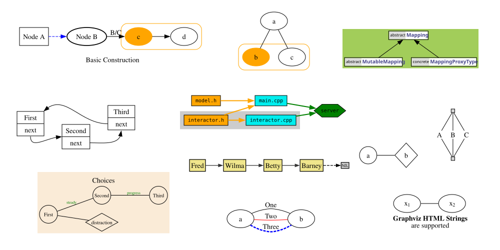

<table align="center">
<tr valign="bottom">
    <td align="center" width="300">
      <a href="https://github.com/escreven/gvdot/blob/main/examples/nfa.ipynb">
        
        <br></br>
        <br><strong>nfa.ipynb</strong></b>
      </a>
    </td>
    <td align="center" width="300">
      <a href="https://github.com/escreven/gvdot/blob/main/examples/er-diagram.ipynb">
        
        <br><strong>er-diagram.ipynb</strong></b>
      </a>
    </td>
</tr>
</table><table align="center">
<tr valign="bottom">
    <td align="center" width="300">
      <a href="https://github.com/escreven/gvdot/blob/main/examples/red-black-tree.ipynb">
        
        <br><strong>red-black-tree.ipynb</strong>
      </a>
    </td>
    <td align="center" width="300">
      <a href="https://github.com/escreven/gvdot/blob/main/examples/sqlite-schema.ipynb">
        
        <br>
        <br><strong>sqlite-schema.ipynb</strong>
      </a>
    </td>
</tr>
</table><table align="center">
<tr valign="bottom">
    <td align="center" width="600">
      <a href="https://github.com/escreven/gvdot/blob/main/examples/quicktour.ipynb">
        
        <br><strong>quicktour.ipynb</strong>
      </a>
    </td>
</tr>
</table>

### Notebooks

* **[er-diagram.ipynb](er-diagram.ipynb)** — Reproduces a [Graphviz
  gallery](https://graphviz.org/gallery) entity relationship diagram, then
  shows how to use themes and roles to separate presentation from structure
  when generating diagrams from models.

* **[nfa.ipynb](nfa.ipynb)** — Demonstrates nondeterministic finite automata
  diagram generation from an NFA definition.

* **[quicktour.ipynb](quicktour.ipynb)** — Walks concisely through gvdot.

* **[red-black-tree.ipynb](red-black-tree.ipynb)** — Creates illustrations for
  students learning about red-black trees.  The generator uses nonces to
  identify phantom nodes steering Graphviz toward better tree layouts.

* **[sqlite-schema.ipynb](sqlite-schema.ipynb)** — Generates schema diagrams
  from SQLite databases.  It uses `gvdot.markup` to create Graphviz HTML node
  labels depicting tables and their columns, and assigns multiple edge roles to
  portray the varying characteristics of foreign keys.

### Other Files

* **[registration.sql](registration.sql)** — Creates the
  **registration.sqlite** sample database.

* **registration.sqlite** - A sample SQLite database read by
  **[sqlite-schema.ipynb](sqlite-schema.ipynb)**.


### Directory `images/`

When run, the example notebooks save generated images to directory
`images/` if it exists.

### Requirements

All notebooks require Graphviz program `dot` to be on `PATH` and configured to
produce SVG output.  [er-diagram.ipynb](er-diagram.ipynb) and
[sqlite-schema.ipynb](sqlite-schema.ipynb) use the `neato` layout engine.
[sqlite-schema.ipynb](sqlite-schema.ipynb) uses the normally built-in `sqlite3`
module.

The `neato` layout engine is not always installed with Graphviz on Linux,
including recent versions of Ubuntu.  To enable these notebooks on Ubuntu 26.04
or later, install Graphviz with

```bash
$ sudo apt-get install --yes graphviz libgvplugin-neato-layout8
```
